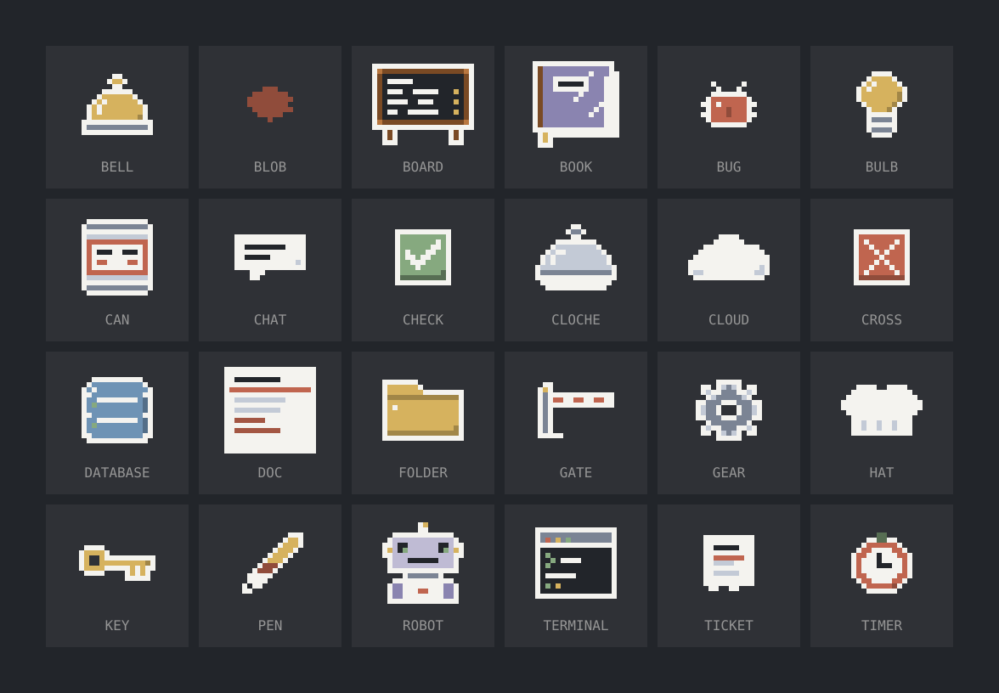

# glyphsprite

**Pixel-art illustrations you type.** Draw a sprite as a few rows of ASCII, and
glyphsprite turns it into a crisp SVG with your colors and your font: infographics,
explainer diagrams, blog covers, social cards. Static, or animated with CSS that
lives inside the file.



```js
export const KEY = [
  ".oooo..........",
  "oyyyyo.........",
  "oy..yoooooooooo",
  "oy..yyyyyyyyyYo",
  "oyyyyoooooyoyoo",
  ".oooo....oyoyo.",
  ".........ooooo.",
];
```



The output is one `.svg` you serve with a plain ``. It stays sharp at any size,
needs no JavaScript, and its animation stops by itself for readers who prefer reduced
motion.

---

## Install

```bash
npx skills add webreactiva/glyphsprite
```

It works with any agent that reads skills. Each
[release](https://github.com/webreactiva/glyphsprite/releases) also ships a
`glyphsprite.zip` you can hand to anyone.

Requirements: **Node 18+** and **playwright** with Chromium in the project where you
build pieces (`npm i -D playwright && npx playwright install chromium`). It measures
text and takes preview frames; the SVGs themselves depend on nothing. Optional:
`pyftsubset` (fonttools + brotli) to shrink embedded fonts.

## Use it

Ask your agent in plain words, or call the skill by name if your agent supports that:

```
glyphsprite: an infographic of the red-green-refactor cycle for my post
glyphsprite: a blog cover for "Your agent forgets everything between sessions"
glyphsprite: animate how a request goes through a load balancer --keep=sources
```

Everything that rebuilds a picture (theme, script, sprites of its own, preview
frames) goes in one `glyphsprite/` folder next to the image. At the end the agent
asks what to keep, and `--keep=…` answers in advance:

- `image`: the image and the theme; the rest of the folder is deleted.
- `sources`: the whole folder, to edit and regenerate the image later.
- `archive`: the image and the theme stay; the rest moves out of the project to
  `~/.cache/glyphsprite/archive/`.

The theme is never deleted with a piece, so the next one keeps the same look.

The agent picks a format, draws or reuses sprites, lays the text out with the real
font, previews the result frame by frame and fixes it before handing it over.

## Your colors, not ours

glyphsprite has no look of its own. It takes a theme from, in this order:

1. what you tell it,
2. a `glyphsprite/theme.json` in your project,
3. a [`DESIGN.md`](https://github.com/google-labs-code/design.md) in your project:
   the darkest color becomes ink, the lightest paper, the rest accents, and the agent
   tells you the mapping before drawing,
4. nothing: it **asks**, and offers a quiet reference palette as one of the answers.

Fonts come from Google Fonts (`"font": { "family": "Inter", "google": true }`) or
from your own files, and are embedded in each SVG, because an SVG inside ``
cannot load external fonts. No font ships with the skill.

Sprite letters are roles, not colors: `r` is "first accent", `y` the third, and so on.
Change the theme and every sprite in the catalog recolors itself. Full format:
[`references/theming.md`](skills/glyphsprite/references/theming.md).

## Examples

Built with the code in `examples/`. Run them with `npm run examples`.

| | Theme | Shows |
|---|---|---|
| [`examples/ship-a-fix.svg`](examples/ship-a-fix.svg) | reference, dark | a four-step cycle with animated parts and a loop-back line |
| [`examples/cover.svg`](examples/cover.svg) | reference, light | a 1200×630 cover: title, one large sprite, a blinking robot |
| [`examples/acme/cache-vs-database.svg`](examples/acme/cache-vs-database.svg) | from [`examples/acme/DESIGN.md`](examples/acme/DESIGN.md) | a comparison, plus a logo mark tinted from the theme |
| [`examples/catalog.svg`](examples/catalog.svg) | reference | every sprite in the catalog |



## Under the hood

What the skill runs for each picture: load the theme, turn ASCII rows into
rectangles, measure text with the real font, pack one SVG, then freeze frames and
look at them until the picture is right.

<p align="center"></p>

## Project layout

```
skills/glyphsprite/            the packaged skill — the only thing distributed
  SKILL.md                     workflow, formats, review loop
  references/theming.md        where colors and fonts come from, theme.json format
  references/drawing-guide.md  sprite legend and drawing rules
  references/animation.md      animation rules and ready keyframes
  scripts/engine.mjs           ASCII → SVG, text measuring, fonts, preview
  scripts/sprites.mjs          the reference catalog
  scripts/catalog.mjs          contact sheet of the catalog under any theme
package-skill.sh               builds glyphsprite.zip for distribution
assets/                        images used by this README
examples/                      example pieces and their built SVGs
tests/                         node:test checks for the engine (npm test)
evals/                         prompts for the skill-creator eval loop
```

## Development

```bash
npm install          # playwright, pinned
npm test             # engine checks
npm run catalog      # rebuild examples/catalog.svg
npm run examples     # rebuild the examples and write review frames to */out/
npm run package      # glyphsprite.zip
```

Releases: push a tag (`git tag v0.2.0 && git push origin v0.2.0`) and the
`release` workflow attaches a fresh `glyphsprite.zip` to a GitHub release.

## Limits

- Text is measured with the theme's font in Chromium. With no font files (system
  fallback), viewers with a different system font may see slightly different wraps.
- The DESIGN.md reader takes only hex colors and the first `fontFamily` from the
  front matter; token references and `oklch()` are skipped.
- Social platforms do not render SVG previews: export a PNG frame for `og:image`.
